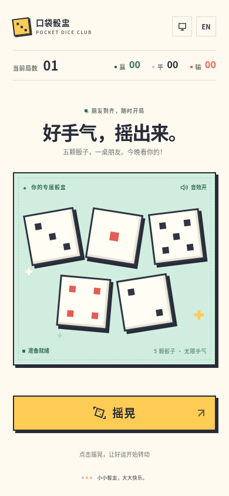
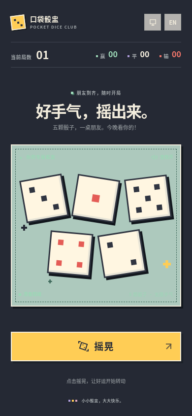

# 口袋骰盅 · Pocket Dice

把手机变成你的随身骰盅。朋友聚会没有骰子时，每个人打开页面，就能拥有自己的五颗骰子。

纯 HTML、CSS 和 JavaScript，零依赖，无需构建、账号或后端。支持中英文、系统浅深色主题和像素音效。

## 界面预览

<p>
  
  
</p>

## 在手机上使用：GitHub Pages

这个项目可以直接部署到 GitHub Pages，不需要安装工具或配置构建流程：

1. 打开仓库的 [Settings → Pages](https://github.com/kuicnz/vc-chinese-dice-game/settings/pages)。
2. 在 **Build and deployment** 下，将 **Source** 设为 **Deploy from a branch**。
3. 选择 **main** 分支和 **/ (root)** 目录，点击 **Save**。
4. 等待 GitHub 完成部署，再打开 Pages 页面显示的网站地址，用手机浏览器访问。

按上述方式开启后，默认网址为：

```text
https://kuicnz.github.io/vc-chinese-dice-game/
```

仓库上传代码和开启 Pages 是两个步骤。首次使用需要在仓库设置中开启 Pages；请以 Pages 页面显示的部署状态与网址为准。之后推送到 `main` 时，网站会自动更新。

## 本地运行

下载仓库后，可以用浏览器打开 `index.html`，也可以在项目目录启动静态服务：

```sh
git clone https://github.com/kuicnz/vc-chinese-dice-game.git
cd vc-chinese-dice-game
python3 -m http.server 8000
```

在电脑浏览器访问 `http://localhost:8000`。如需用手机测试，让手机和电脑连接同一 Wi-Fi，再在手机上访问 `http://电脑的局域网IP:8000`，并允许电脑防火墙的相应访问。

## 怎么玩

每位玩家在自己的手机上打开页面，独立操作自己的骰盅：

1. 点击金色「摇晃」，五颗骰子随机跳动并播放碰撞音；点击红色「停」落定点数。
2. 选择「重摇」继续摇，或「确定」锁定点数，和朋友进行现实中的对局。
3. 选择赢、平或输（默认平局），把底部滑块拖到最右侧结束本局。局数和战绩自动更新，进入下一局。

输赢由玩家自己选择，页面负责记录。滑块没有拖到终点时会回弹，不会结算或改变点数。

## 功能

- 手机固定满屏，适配安全区域、小屏和横屏，不需要上下滚动。
- 明亮像素风格与系统字体；默认跟随系统主题。右上角主题按钮依次切换系统、浅色、深色。
- 中英文切换、音效开关。碰撞音与结算提示音由浏览器即时合成，不加载外部音频。
- 本机浏览器保存战绩、设置、已停下或锁定的骰子，以及选中的结果。存储不可用时仍能正常游玩，但刷新后不保留状态。
- 滑动不足会自动回弹；支持触摸、鼠标及键盘。聚焦滑块后，可用方向键移动，或按 End / Enter / 空格完成结算。
- 尊重系统「减少动态效果」设置；切换到后台时自动停骰并暂停音效。
- 最终点数优先使用浏览器的加密随机数生成，每颗骰子独立随机。

声音会在首次点击后启用，也受设备音量和浏览器设置影响。战绩保存在当前设备、当前浏览器的网站存储中，不会在不同设备间同步；清除网站数据会清空记录。

## 文件

- `index.html`：页面结构。
- `styles.css`：像素样式、浅深色主题和响应式布局。
- `app.js`：骰子状态、音效、语言、计分和滑动交互。
- `docs/`：README 使用的浅色、深色界面截图。

修改上述文件后刷新页面即可，无需 `npm install` 或编译。

## 已验证

在 Chromium 浏览器中完成了 20 项交互检查，以及覆盖 7 种屏幕尺寸、3 个主要状态的 21 项布局检查：

- 摇晃、停止、重摇、确认锁定、触屏滑动、未完成滑动回弹与键盘结算。
- 赢、平、输的计数更新，以及刷新后的战绩、锁定点数和设置恢复。
- 中英文、浅深色主题、音效开关和减少动态效果设置。
- 320 × 568、375 × 667、390 × 844 的手机竖屏，667 × 375 的横屏，以及三种桌面尺寸。

这些检查使用浏览器模拟尺寸与触摸输入；iOS Safari 和 Android 真机体验仍建议通过部署后的网址确认。

## 许可

[MIT License](LICENSE)。
